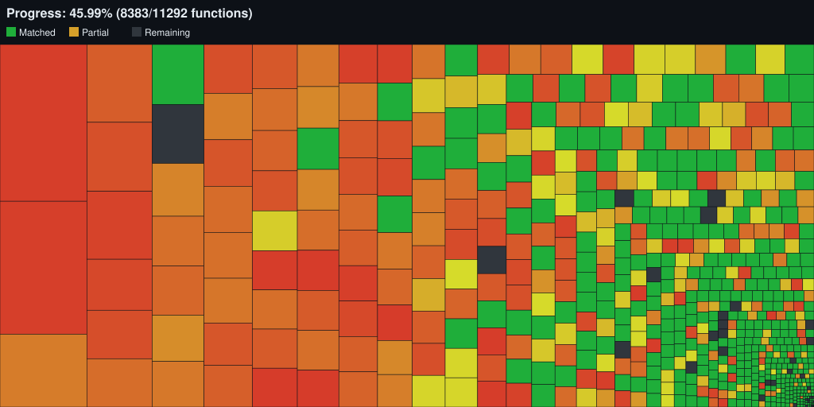

# Naruto Shippuden: Clash of Ninja Revolution 3

[Versión en español](README.md) · [Contributing Guide](CONTRIBUTING.md)

A work-in-progress C/C++ matching decompilation of **Naruto Shippuden: Clash of Ninja Revolution 3** (Wii, PAL/Europe).

The goal of this project is to match the original game binary (`main.dol`) byte-for-byte, reverse engineer Eighting's game engine, and provide a clean, documented foundation for preservation, research, and future native PC ports.



## Progress

| Category | Progress | Matched / Total |
|---|---|---|
| **Total Code** | **46.00%** | 1.52 MB / 3.30 MB (8,385 / 11,292 functions) |
| · Game Code | **28.81%** | 449.8 KB / 1.56 MB (3,540 / 4,923 functions) |
| · SDK / Libraries (*RVL, NW4R, MSL, DWC...*) | **61.44%** | 1.07 MB / 1.74 MB (4,845 / 6,369 functions) |
| Data (`.data`, `.rodata`, `.bss`) | 0.01% | 100 B / 1.54 MB |

*(Run `python configure.py progress` for live numbers).*

## Supported Version

| Game ID | Region | Platform | Target |
|---|---|---|---|
| `RNEPDA` | Europe / PAL | Nintendo Wii | `sys/main.dol` |

## Project Goals

- **1:1 Matching:** Produce byte-identical machine code when compiled with Metrowerks CodeWarrior.
- **Clean C++:** Reconstruct true data structures, class hierarchies, and types rather than relying on raw offset arithmetic or synthetic vtables.
- **Engine Documentation:** Understand and document Eighting's Wii game engine (physics, animation, particle systems, battle logic, UI).
- **Preservation & Portability:** Create a maintainable C++ codebase to facilitate future research, modding tools, and native PC recompilations.

## Building

### Prerequisites

- **Python 3** (added to `%PATH%`)
- **[Ninja](https://ninja-build.org/)**

The build toolchain (decomp-toolkit, objdiff-cli, Metrowerks CodeWarrior compilers, and PowerPC binutils) is downloaded automatically into `build/` during the first configure step.

### Setup Instructions

1. **Clone the repository:**
   ```sh
   git clone https://github.com/daviddaco1/NCONR3decomp.git
   cd NCONR3decomp
   ```

2. **Extract the game executable:**
   Place a clean, legally dumped European copy of the game executable (`main.dol`) at:
   ```
   orig/RNEPDA/sys/main.dol
   ```

3. **Configure the project:**
   ```sh
   python configure.py
   ```

4. **Build:**
   ```sh
   ninja
   ```

To quickly build a single object file during development:
```sh
ninja build/RNEPDA/src/filename.o
```

## Diffing with objdiff

The project is pre-configured for interactive diffing using [objdiff](https://github.com/encounter/objdiff):

1. Download the latest release of **objdiff**.
2. Open the repository root folder in objdiff (it will load `objdiff.json` automatically).
3. Select any object file to start diffing (original binary vs. your compiled code).
4. Re-running `ninja build/RNEPDA/src/<file>.o` will update the diff view in real time.

## Tooling & Methodology

This project follows standard methodologies used by the GameCube/Wii decompilation community:
- Built with Luke Street's [dtk-template](https://github.com/encounter/dtk-template).
- Helper tools: [m2c](https://github.com/matt-kempster/m2c) and permutation scripts to accelerate instruction matching.
- **Tooling & AI assistance disclosure:** Automated decompilers and LLMs are used as low-level assistants to generate initial scratches. All functions are reviewed and refactored toward clean and idiomatic C++ with proper types and naming.

## Contributing

Contributions are very welcome! We are especially looking for help with:
- Recovering types and struct layouts in `include/`.
- Replacing hardcoded offset arithmetic with meaningful member accesses.
- Matching remaining functions.
- Carving out `.rodata`, `.data`, and `.bss` slices.

Check out the [Contributing Guide](CONTRIBUTING.md) for code style guidelines and workflow details.

## Legal

This repository does not contain or distribute copyrighted assets, disc images, original binaries, or proprietary game code. A legally obtained copy of *Naruto Shippuden: Clash of Ninja Revolution 3* is required to build and verify this project.
