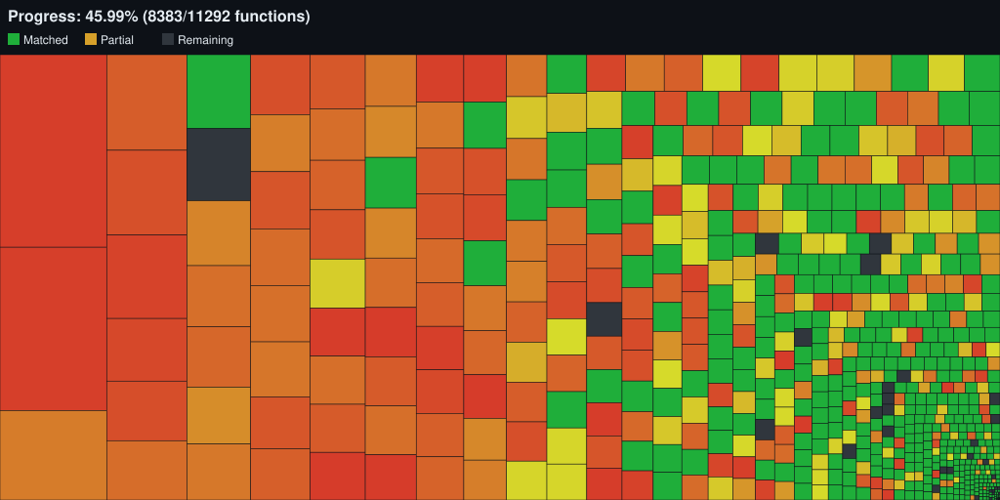

# Naruto Shippuden: Clash of Ninja Revolution 3

[English version](README.en.md) · [Guía de contribución](CONTRIBUTING.md)

Descompilación por coincidencia (*matching decompilation*) en C/C++ de **Naruto Shippuden: Clash of Ninja Revolution 3** (Wii, versión PAL/Europa).

El objetivo del proyecto es reconstruir código fuente equivalente byte a byte al ejecutable original (`main.dol`), documentando el motor de juego de Eighting y facilitando la preservación, investigación y futuros ports nativos a PC.



## Progreso

| Categoría | Progreso | Matched / Total |
|---|---|---|
| **Código total** | **46.00%** | 1.52 MB / 3.30 MB (8,385 / 11,292 funciones) |
| · Código del juego (*Game Code*) | **28.81%** | 449.8 KB / 1.56 MB (3,540 / 4,923 funciones) |
| · Librerías y SDK (*RVL, NW4R, MSL, DWC...*) | **61.44%** | 1.07 MB / 1.74 MB (4,845 / 6,369 funciones) |
| Datos (`.data`, `.rodata`, `.bss`) | 0.01% | 100 B / 1.54 MB |

*(Ejecuta `python configure.py progress` para ver las cifras en tiempo real).*

## Versión soportada

| Game ID | Región | Plataforma | Archivo objetivo |
|---|---|---|---|
| `RNEPDA` | Europa / PAL | Nintendo Wii | `sys/main.dol` |

## Objetivos del proyecto

- **Matching 1:1:** Obtener un ejecutable byte a byte idéntico al compilar con Metrowerks CodeWarrior.
- **C++ limpio y tipado:** Reconstruir estructuras de datos, jerarquías de clases y tipos reales en lugar de depender de aritmética de punteros o vtables sintéticas.
- **Documentación del motor:** Investigar y documentar los subsistemas del motor de Eighting (animación, efectos de partículas, cámaras, lógica de combate, interfaz).
- **Preservación y portabilidad:** Servir como base de código limpia y documentada para futuros ports nativos a PC y herramientas de modding.

## Compilación

### Prerrequisitos

- **Python 3** (añadido al `%PATH%`)
- **[Ninja](https://ninja-build.org/)**

Las herramientas del toolchain (decomp-toolkit, objdiff-cli, compiladores CodeWarrior y binutils de PowerPC) se descargan automáticamente en `build/` durante la primera configuración.

### Instrucciones paso a paso

1. **Clonar el repositorio:**
   ```sh
   git clone https://github.com/daviddaco1/NCONR3decomp.git
   cd NCONR3decomp
   ```

2. **Extraer el ejecutable del juego:**
   Coloca una copia limpia y legalmente obtenida del ejecutable europeo (`main.dol`) en:
   ```
   orig/RNEPDA/sys/main.dol
   ```

3. **Configurar el proyecto:**
   ```sh
   python configure.py
   ```

4. **Compilar:**
   ```sh
   ninja
   ```

Para compilar un único archivo de forma rápida durante el desarrollo:
```sh
ninja build/RNEPDA/src/archivo.o
```

## Comparación y diffing (objdiff)

El proyecto está configurado para usarse con [objdiff](https://github.com/encounter/objdiff):

1. Descarga la versión más reciente de **objdiff**.
2. Abre la raíz de este repositorio como directorio de proyecto (cargará `objdiff.json` automáticamente).
3. Selecciona cualquier archivo objeto en la lista para ver la comparación lado a lado (código original vs. tu código compilado).
4. Al modificar el código y recompilar con `ninja build/RNEPDA/src/<archivo>.o`, objdiff actualizará la vista en tiempo real.

## Metodología y herramientas

El proyecto sigue la metodología estándar de la comunidad de descompilación de GameCube y Wii:
- Basado en [dtk-template](https://github.com/encounter/dtk-template) de Luke Street.
- Herramientas auxiliares: [m2c](https://github.com/matt-kempster/m2c) y scripts de permutación para acelerar el emparejamiento de instrucciones en ensamblador.
- **Uso de automatización e IA:** Se utilizan herramientas automáticas y asistencia de LLMs para generar borradores iniciales (*scratches*) de bajo nivel. Todas las funciones se revisan, limpian y refactorizan manualmente para convertirlas en C++ legible con tipos y nombres reales.

## Contribuciones

¡Cualquier ayuda es bienvenida! Buscamos apoyo principalmente en:
- Identificación y recuperación de tipos y structs en `include/`.
- Reemplazo de accesos por offsets directos en funciones de juego.
- Descompilación de funciones pendientes.
- Separación de secciones de datos (`.data`, `.rodata`, `.bss`).

Consulta la [Guía de Contribución](CONTRIBUTING.md) para ver convenciones de código y el flujo de trabajo para enviar Pull Requests.

## Legal

Este repositorio no incluye ni distribuye material protegido por derechos de autor, ISOs, ejecutables originales ni assets comerciales. Para compilar y verificar el proyecto es necesario disponer de una copia legítima de *Naruto Shippuden: Clash of Ninja Revolution 3*.
