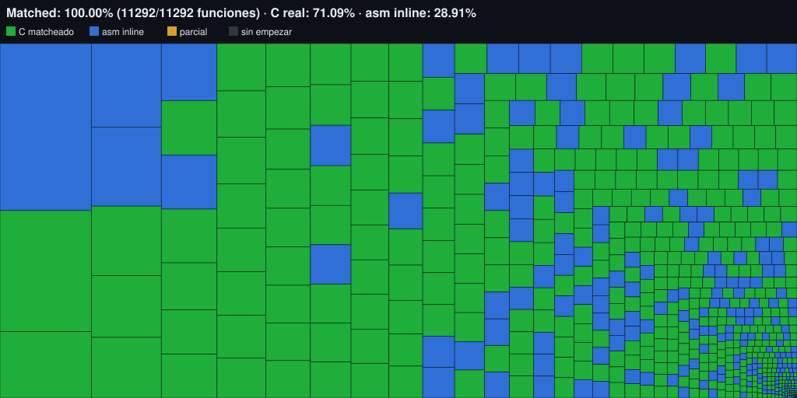

# Naruto Shippuden: Clash of Ninja Revolution 3 (Decompilation)

[English version](README.en.md)

Descompilación por coincidencia (*matching decompilation*) de **Naruto Shippuden: Clash of
Ninja Revolution 3** (Wii), con el objetivo de portearlo a PC.



*Verde: C real matcheado · azul: asm inline (matchea pero aún no es C) · gris: sin empezar.*

## Legal

Este repositorio no distribuye ni incluye ningún ISO, DOL, asset o archivo extraído del juego.
Todo el contenido bajo `orig/` está excluido vía `.gitignore` y nunca debe commitearse. Para
compilar hace falta una copia legítima del juego, provista por el usuario.

## Versión soportada

| Game ID | Región |
|---|---|
| `RNEPDA` | Europa/PAL |

## Cómo funciona

Se escribe código C/C++ que, compilado con el compilador original del juego (Metrowerks
CodeWarrior para Wii), produce código byte-idéntico al `main.dol`. Una función que matchea así
queda confirmada como la implementación real y puede modificarse o portarse con seguridad. Es el
método estándar de la comunidad GC/Wii (Wind Waker, Pikmin, Melee, Skyward Sword...).

El ejecutable se divide en *translation units* (TUs, un archivo fuente cada una) según
`config/RNEPDA/splits.txt`. Cada TU tiene uno de estos fuentes:

- **C/C++ real**: escrito a mano, importado de otro proyecto de descompilación (librerías de
  Nintendo/Metrowerks) o generado con [m2c](https://github.com/matt-kempster/m2c) y verificado.
- **asm**: el código original como ensamblador inline, a la espera de ser reescrito.
- **mixto**: C para las funciones que ya matchean y asm para el resto.

## Estado

| | |
|---|---|
| Código matcheado (asm + C) | **100%** (3.3 MB, 11,293 funciones) |
| Código en C real | ≈10.9% |
| Datos | 0% (sin splits de datos todavía) |
| `.text` splitteado | 100% |

`python configure.py progress` muestra los números actualizados (la línea "C code" es el C real).
El historial detallado está en [`docs/decompilation_log.md`](docs/decompilation_log.md).

## Dependencias

- **Python 3**
- **[ninja](https://github.com/ninja-build/ninja)**

El resto del toolchain (decomp-toolkit, objdiff-cli, binutils PPC, wibo y los compiladores
Metrowerks CodeWarrior) se descarga automáticamente la primera vez. Detalle por sistema
operativo en [`docs/dependencies.md`](docs/dependencies.md). Para la generación automática de C
hace falta además un clon de m2c (GPL, no incluido) con `M2C_DIR` apuntando a él.

## Uso

1. Copiar el juego en `orig/RNEPDA/` (imagen de disco o archivos extraídos; se lee
   `sys/main.dol`).
2. Compilar:

```sh
python setup.py                # opcional: verifica prerrequisitos e integridad del dump
python configure.py            # genera build.ninja + objdiff.json
ninja                          # compila
python configure.py progress   # progreso
python tools/progress_svg.py   # regenera docs/progress.svg (tras ninja)
sha1sum -c config/RNEPDA/build.sha1   # verifica que el DOL reconstruido es idéntico
```

No hay test suite: la verificación es que `ninja` compile y que `build.sha1` matchee. Para
trabajar función por función se usa [objdiff](https://github.com/encounter/objdiff), abriendo la
raíz del repo como *project directory*.

## Estructura

| Ruta | Contenido |
|---|---|
| `config/RNEPDA/` | `config.yml`, `splits.txt` (TUs), `symbols.txt` (nombres), `build.sha1` |
| `configure.py` | Definición del build: libs, objetos, flags de compilación por zona |
| `src/` | Fuentes del juego y de librerías (C, mixtos o asm), uno por TU |
| `include/` | Headers del juego |
| `libs/` | Código de terceros importado (ver abajo) |
| `tools/` | Herramientas de dtk-template y propias del proyecto (splits, símbolos, asm → C) |
| `docs/` | Bitácora del proyecto y documentación de dtk-template |
| `patches/` | Parches a herramientas externas |
| `orig/` | Dump del juego (no versionado) |
| `build/` | Todo lo generado (no versionado) |

[`CLAUDE.md`](CLAUDE.md) resume la arquitectura del build, los flags verificados por zona y los
gotchas conocidos.

## Código de terceros

`libs/` contiene fuentes y headers de MSL/Runtime/MetroTRK, RVL SDK y NW4R de
[xbret/xenoblade](https://github.com/xbret/xenoblade), GameSpy de
[doldecomp/mkw](https://github.com/doldecomp/mkw) y partes de NW4R de
[zeldaret/ss](https://github.com/zeldaret/ss), todos bajo CC0 (licencia en cada `libs/<origen>/LICENSE`).
Los nombres de TUs de librerías se tomaron también de esos proyectos y de
[doldecomp/ogws](https://github.com/doldecomp/ogws) y [zeldaret/tp](https://github.com/zeldaret/tp).

## Créditos

Scaffold basado en [dtk-template](https://github.com/encounter/dtk-template) de Luke Street
(encounter). Herramientas: [decomp-toolkit](https://github.com/encounter/decomp-toolkit),
[objdiff](https://github.com/encounter/objdiff), [m2c](https://github.com/matt-kempster/m2c),
[decomp.me](https://decomp.me), [decomp.dev](https://decomp.dev),
[wibo](https://github.com/decompals/wibo).
